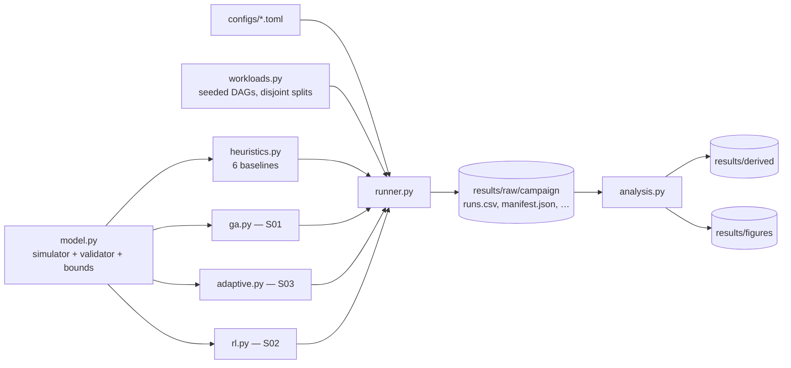

# CS15 — AI-Based and Adaptive Scheduling (BCSE412L Parallel Computing)

Simulation-based comparison of three AI-based schedulers for task DAGs on heterogeneous processors, against the same
baseline heuristics on identical workloads:

| Sub-problem | Method | Research question (manual) |
|---|---|---|
| **S01** Evolutionary task scheduling | Genetic algorithm (random keys + processor assignment), seeded with heuristics, with equal-budget controls | Can evolutionary optimization reduce makespan compared with baseline heuristics? |
| **S02** RL-based scheduling | REINFORCE policy choosing (ready task, processor) pairs | Can RL scheduling improve over a conventional heuristic after training? |
| **S03** Adaptive workload-aware scheduler | Decision-tree selector choosing one of six heuristics per instance (+ a separately labelled GA extension) | Can an adaptive scheduler outperform a fixed scheduling policy across diverse workloads? |

**Status (2026-10-17):** all three final campaigns are run, verified and technically accepted. The report drafts are in
`docs/report/`. **Not submission-ready** — see [Outstanding blockers](#outstanding-submission-blockers).

## Simulated makespan vs measured overhead

Two kinds of time appear everywhere and are **never added together**:

- **Makespan** (`makespan_sim`, `Execution_Time`, unit `sim_tu`) is produced by the scheduling **simulator**: the length
  of the schedule if tasks took exactly their modelled costs (mean task work 100 `sim_tu`; no communication cost). All
  quality results of the S01, S02 and S03 campaigns — makespan, `Cmax/LB`, speedup, efficiency, utilization,
  improvement — are simulated, and those campaigns claim no hardware speedup.
- **Measured execution** (`wall_s`, `Execution_Time` in seconds in the measured campaign
  `results/raw/20261018T015324Z-omp_exec_final-9c4c1f9b`) is a separate layer: the accepted schedules were executed
  with C++/OpenMP on the Apple M4 (`docs/MD_ACCEPTANCE_REPORT.md`). Its speedups (baseline: `SERIAL`, same instance and
  granularity) are measured on that one host only and are never mixed with simulated makespans.
- **Scheduling / optimization / decision / inference time** (`scheduling_time_s`, `Scheduling_Time`, seconds) is
  **measured** wall-clock time of the scheduler call on the host (Apple M4). It is the real cost of producing a
  schedule.

Speedup is always `serial_best / makespan`, where `serial_best` = all tasks run sequentially on the single best
simulated processor (`Speedup_Baseline` column).

## Architecture

One package, `schedlab`; every sub-problem reuses the same simulator, validator, workloads, baselines, runner and
analysis. Full design: `docs/ARCHITECTURE.md`; diagram source: `docs/architecture_diagram.mmd`.



| Path | Purpose |
|---|---|
| `schedlab/model.py` | `Instance`, `ScheduleBuilder` (execution simulator, gap insertion), independent `validate()`, lower bound and speedup baseline |
| `schedlab/workloads.py` | seeded layered / fork-join DAG generator, 4 workload classes, out-of-distribution sets, content hashes, split separation |
| `schedlab/heuristics.py` | `FCFS-EAT`, `FCFS-EFT`, `SPT-EFT`, `LPT-EFT`, `HEFT`, `MINMIN` |
| `schedlab/ga.py` | S01: `GA`, `GA-UNSEEDED`, `GA-KEYS-EFT`, `RANDOM-SEARCH`, `HILL-CLIMB` |
| `schedlab/adaptive.py` | S03: workload features, selector, novelty guard, `ADAPTIVE*`, `TRY-ALL`, `RANDOM-SELECT`; `ADAPTIVE-GA`, `GA-1000` extension |
| `schedlab/rl.py` | S02: candidate features, REINFORCE trainer, greedy policy |
| `schedlab/runner.py` | campaigns: identical instances for every method, timing, raw CSV, manifest, model-id pinning, power-source recording |
| `schedlab/analysis.py` | manual's 19-column `master.csv`, summary and paired tables, figures, campaign integrity checks |
| `schedlab/__main__.py` | CLI: `run`, `analyze`, `train-selector`, `train-rl` |
| `tests/` | 261 tests at the last verified run, 2026-10-18 (238 before the C++/OpenMP milestones; `pytest.ini` sets `pythonpath = .`) |
| `configs/` | campaign / training configs (below) |
| `docs/` | design, methodology, data schema, validation plan, roadmap, acceptance and pilot reports; `docs/report/` report drafts |
| `provenance/` | per final campaign: execution snapshot, independent verifier, provenance records |

## Requirements

Verified versions on the development machine (Apple M4, 10 cores, 16 GB, macOS 27.2 arm64):

- Python **3.12.9**
- `requirements.txt` (pinned): numpy 2.4.4, scipy 1.17.1, scikit-learn 1.8.0, torch 2.11.0 (CPU), matplotlib 3.10.8,
  pandas 3.0.2, pytest 9.1.1
- C++ components (`cpp/`): Homebrew GCC **15.2** (`g++-15`, libgomp OpenMP); build with `make -C cpp`
  (flags in `cpp/Makefile`; details and file formats in `cpp/README.md`)
- Only for rebuilding the Word documents: python-docx 1.2.0 (already installed here; not in `requirements.txt`)
- Optional, for rendering the Word documents to PDF: LibreOffice (`soffice`)

```bash
python3 -m pip install -r requirements.txt
```

Run every command from the repository root.

## Commands

**Tested on 2026-10-17** (the outputs of the analysis/verification commands were written to a scratch directory and
matched the accepted derived CSVs byte for byte):

```bash
python3 -m pytest -q
```
→ 261 passed (~110 s; re-run 2026-10-18, after `make -C cpp`).

```bash
python3 -m schedlab analyze results/raw/20261017T044734Z-s01_final-430d8a10 --out /tmp/cs15_check
```
→ regenerates S01 `master.csv`, tables and figures under `/tmp/cs15_check/{derived,figures}/<campaign>/` (~11 s);
`campaign checks: all passed`. Same for `results/raw/20261017T083329Z-s03_final-b8e5be9a` (S03, ~6 s) and
`results/raw/20261017T115054Z-s02_final-898ee9e1` (S02, ~5 s). **Without `--out`, `analyze` overwrites the accepted
files in `results/derived/` and `results/figures/`** (CSV content is reproduced exactly, but PDF/SVG bytes and their
recorded hashes change).

```bash
PYTHONPATH=. python3 provenance/s03_final/verify_campaign.py results/raw/20261017T083329Z-s03_final-b8e5be9a results/derived/20261017T083329Z-s03_final-b8e5be9a /tmp/cs15_verify_s03.json
```
→ independent integrity check, `"problems": []` (~7 s). Likewise `provenance/s01_final/verify_campaign.py` (~6 s)
and `provenance/s02_final/verify_campaign.py` (~30 s; re-runs every RL schedule) with their campaign ids. Give an
output path outside `provenance/` so the recorded result files are not overwritten.

```bash
python3 -m schedlab run --config configs/pilot.toml --out /tmp/cs15_raw
```
→ small heuristics-only pilot on `val` (432 rows, < 1 s). Every `run` writes a new timestamped directory; it never
overwrites an existing campaign.

```bash
python3 -m schedlab analyze results/raw/20261017T115054Z-s02_final-898ee9e1 --out /tmp/cs15_final --final
```
→ **refuses** (`Student_ID / Batch_ID are still placeholders`) until `configs/identity.toml` holds confirmed values.

**Documented, not executed in this phase** (they were executed earlier, as recorded in the acceptance reports and
provenance; re-running them creates new campaigns or models):

| Purpose | Command | Cost (measured when run) |
|---|---|---|
| S01 final campaign | `python3 -m schedlab run --config configs/s01_final.toml` | 7,106 s |
| S03 selector training | `python3 -m schedlab train-selector --config configs/s03_pilot.toml` (writes `results/models/s03_selector_v1`; refuses to overwrite) | ~10 s |
| S03 GA extension training | `python3 -m schedlab train-selector --ga --config configs/s03_pilot_ga.toml` (writes `s03_selector_ga_v2`) | ~150 s |
| S03 final campaign | `python3 -m schedlab run --config configs/s03_final.toml` | 237 s |
| S02 training (per model) | `python3 -m schedlab train-rl --config configs/s02_train.toml --seed {0,1,2} --out results/models/s02_rl_seed{0,1,2}`; ablation: `--seed 0 --ablation --out results/models/s02_rl_noheftfeat_seed0` | ~16 min each, mains power |
| S02 final campaign | `python3 -m schedlab run --config configs/s02_final.toml` | 80 s |
| Pilots | `configs/{ga_pilot,s03_pilot,s03_pilot_ga,s02_pilot,cost_probe}.toml` with `run` | seconds to minutes |

**C++/OpenMP (milestones M-A–M-D, tested 2026-10-17/18).** Build, cross-language checks, re-derivation of the
accepted schedules, and analysis of the measured campaign (write to a scratch directory to leave accepted files
untouched):

```bash
make -C cpp
```

```bash
python3 -m pytest -q tests/test_cpp_interop.py tests/test_ompexec.py
```

```bash
python3 -m schedlab.interop xval-heuristics --config configs/s01_final.toml --campaign results/raw/20261017T044734Z-s01_final-430d8a10 --campaign results/raw/20261017T083329Z-s03_final-b8e5be9a --campaign results/raw/20261017T115054Z-s02_final-898ee9e1 --out /tmp/cs15_xval
```

```bash
python3 -m schedlab.rederive --workers 8 --out /tmp/cs15_rederive
```
→ ≈ 37 min with 8 worker processes (offline check only; nothing is timed).

```bash
python3 -m schedlab.omp_analysis results/raw/20261018T015324Z-omp_exec_final-9c4c1f9b --out-root /tmp/cs15_md
```

```bash
python3 -m schedlab.omp_analysis results/raw/20261018T015324Z-omp_exec_final-9c4c1f9b --check-traces
```

```bash
python3 -m schedlab.omp_master results/raw/20261018T015324Z-omp_exec_final-9c4c1f9b --out-root /tmp/cs15_md
```

The measured campaign itself (`python -m schedlab.ompexec final --config configs/omp_exec_final.toml`, ≈ 54 min on
mains power) was run once and is locked; its lock no longer matches the tree after the post-run driver fix, so it
cannot be started again by accident. Calibration: `python -m schedlab.ompexec calibrate`.

Final configs pin their model ids (`[s03] model_id`, `[s02] model_ids`); the runner refuses to start if a model on
disk differs. Re-training writes a new directory and must not reuse an accepted model's path.

## Accepted results — where everything is

| Sub-problem | Raw campaign (immutable) | Report |
|---|---|---|
| S01 | `results/raw/20261017T044734Z-s01_final-430d8a10/` | `docs/S01_ACCEPTANCE_REPORT.md` |
| S03 | `results/raw/20261017T083329Z-s03_final-b8e5be9a/` | `docs/S03_ACCEPTANCE_REPORT.md` |
| S02 | `results/raw/20261017T115054Z-s02_final-898ee9e1/` | `docs/S02_ACCEPTANCE_REPORT.md` |
| C++ reproduction | `results/raw/20261017T161212Z-cpp_xval_heuristics-545fdfc6/`, `results/raw/20261017T162329Z-rederive-21e353a7/` | `cpp/README.md` |
| Measured C++/OpenMP replay | `results/raw/20261018T015324Z-omp_exec_final-9c4c1f9b/` (manifest reconstructed after a driver crash; see report §2) | `docs/MD_ACCEPTANCE_REPORT.md` |

- Raw files per campaign: `runs.csv` (one row per instance × method × repeat/seed), `manifest.json` (config, hardware,
  software, models, counts, power source for S02), `run.log`, `ga_trace.csv` (S01 convergence), `decisions.csv`
  (S03 selections). All read-only.
- Derived: `results/derived/<campaign>/` — `master.csv` (manual's 19 columns first), `summary_by_algorithm.csv`,
  `timing_by_size.csv`, and `s01_*`, `s03_*`, `s02_*` tables.
- Figures: `results/figures/<campaign>/` — each figure as PDF + SVG + per-instance/per-run CSV + plotted-summary CSV.
  S02 training curves for the final models also in `results/figures/s02_training/`.
- Models: `results/models/s03_selector_v1` (`820ba281844c513e`), `s03_selector_ga_v2` (`6d83fac40cb5c6ed`),
  `s02_rl_seed{0,1,2}` (`c827a9f51c512ac4`, `e83496e27b9d4ef1`, `1765acd48d43dfde`), `s02_rl_noheftfeat_seed0`
  (`a7781d888bca8550`); superseded and pilot models are listed in `results/PILOT_INDEX.md`.
- Provenance: `provenance/s0{1,2,3}_final/` — `EXECUTION_PROVENANCE.md`, read-only `execution_snapshot/`,
  `verify_campaign.py` + result, `POSTPROCESSING_PROVENANCE.json` (sha256 of every raw, derived, figure and model file),
  figure reproducibility check, report amendments.
- All campaigns and pilots, including superseded ones: `results/PILOT_INDEX.md`.

## Reproducibility

- **Seeds.** Workload campaign seed `20261011` (all final configs and `full.toml`); every instance is generated from
  `SeedSequence([campaign_seed, split, crc32(family/class/cv), n, m, index])`, so splits cannot collide, and content
  hashes are checked for separation at the start of every campaign. S01 algorithm seeds 0, 1, 2; S03 `RANDOM-SELECT` /
  extension seeds 0, 1, 2; S02 training seeds 0, 1, 2 and a shared training stream seeded `20261017` (train split,
  indices ≥ 1000); bootstrap seed `20261017`.
- **Configs.** `full.toml` defines the workload matrix; `s01_final.toml`, `s03_final.toml`, `s02_final.toml` are the
  locked final configs (lock tests in `tests/`); `s02_train.toml` the S02 training settings; `identity.toml` the
  `Student_ID`/`Batch_ID` placeholders.
- **Determinism.** All schedulers are deterministic given their seed; RL uses one thread and
  `torch.use_deterministic_algorithms(True)`; retraining reproduces model ids; re-analysis reproduces derived CSVs.
  Measured times vary between runs and machines.
- **Data separation.** `train` (S03 labels; S02 stream) → `val` (all selection and checkpointing) → `test_id`,
  `test_ood` (final evaluation only, once per sub-problem).

## Headline results (simulated makespan; details and caveats in the acceptance reports)

| | Primary comparison | Result |
|---|---|---|
| S01 | `GA` vs per-instance best heuristic (450 test instances) | +1.169% mean paired improvement, p = 6.2e-52; at ~1,100–1,730× HEFT's scheduling time; equal-budget hill climb +0.90%, keys-only GA ablation +3.38% |
| S03 | `ADAPTIVE` vs single best fixed policy (`HEFT`, chosen on `val`), `test_id` | −0.016%, p = 0.78 — **no improvement** (null result) |
| S02 | `RL` (mean of 3 seeds) vs `HEFT`, `test_id` | ρ = 1.0097 (RL ~1% worse, p = 6.8e-6), within the predeclared ±2% "matches" band; ~18% better than `FCFS-EAT` |
| Measured (C++/OpenMP, seconds) | 1 ms tasks, 360 `test_id`: `GA` vs `HEFT`; `ADAPTIVE` incl. decision time vs `HEFT`; OpenMP tasks vs static `HEFT` | 0.984 (CI 0.980–0.988), 1.008, 1.188 (all Holm-significant); GA's gain mostly within noise per instance and absent at 8 threads; HEFT speedup 1.93 / 3.15 / 3.39 at 2 / 4 / 8 threads |

## Known limitations

Quality results are simulated (no communication costs, exact cost estimates); the measured replay runs a synthetic
compute kernel on one Apple M4 without thread pinning (slowdown at 8 threads consistent with efficiency cores,
inferred from task timings; ≈ 8% serial calibration offset); one synthetic
workload generator; S01 and S03 timings measured on battery power; three RL training seeds; the S01 analysis
population was not predeclared; literature full texts read for [1], [4], [8], [12], [13] and partly for [2], [3], [5], [9], with the rest at abstract or metadata level. See the acceptance reports and
`docs/report/CS15_Integrated_Report_DRAFT.md` §8.

## Outstanding submission blockers

- Faculty approval of **one student covering S01, S02 and S03**, and confirmation that the added **C++ simulator and
  OpenMP execution** meet the tooling requirement.
- **`Student_ID` and `Batch_ID`** not confirmed (placeholders in `configs/identity.toml`).
- **Findings from Batches 1–3 and 7** unavailable: the S03 objective to use them is **not met**.
- **Technical-note format** (one combined note or one per sub-problem) to be confirmed with the faculty.
- **Full texts not yet read** for [6], [7], [10], [16] ([5] only partially verified); report corrections C1–C5 from the claim check are applied; see
  `docs/report/CITATION_VERIFICATION.md`.
- Word documents: corrected drafts in `docs/report/word/` (Microsoft Word, re-measured 2026-10-18: report 12 pages, note 3, literature
  review 5; rebuild with `python3 docs/report/build_docx.py`). Final export waits on the identifiers and approvals.

**Deadline (confirmed): 30 October 2026** — the manual copy says 19 October 2026; the discrepancy is recorded in
`docs/report/COMPLIANCE_AUDIT.md`, which also lists the corrections applied and the action for each blocker.

Checklist: `docs/report/SUBMISSION_CHECKLIST.md`. Corrections log: `docs/report/ERRATA.md`. Audit: `docs/report/COMPLIANCE_AUDIT.md`.
